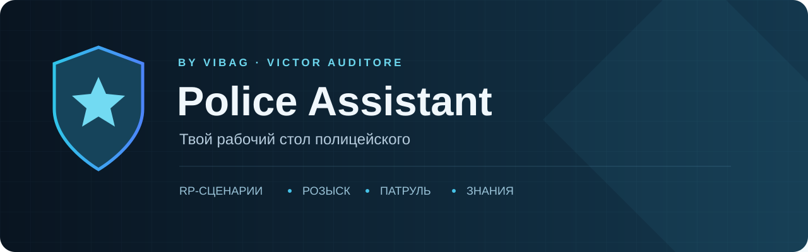
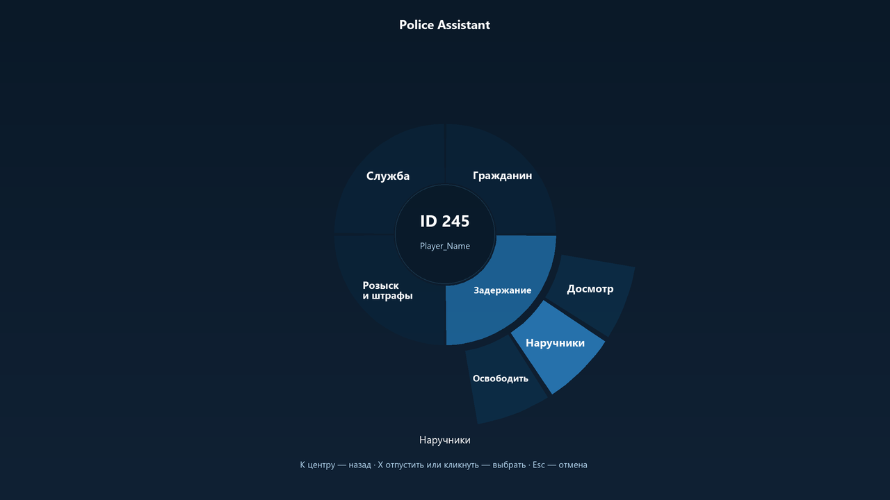

**Твой рабочий стол полицейского — прямо в GTA San Andreas.**

RP-сценарии · розыск · патруль · рация · база знаний

### [Скачать последнюю версию →](https://github.com/VIBAG-bg/Police-Assistant/releases/latest) · [Установка](docs/INSTALLATION.md) · [Руководство](docs/GUIDE.md) · [Обновления](docs/UPDATES.md)

Создан **VIBAG · Victor Auditore** для повседневной работы ПД на Exsellent RP.

## Меньше рутины. Больше контроля.

Police Assistant собирает привычные действия сотрудника в одном русском интерфейсе. Настрой отыгровки под себя, выбери нужного игрока, подготовь доклад и проверь его перед отправкой. Бинды и заметки хранятся отдельно — ими удобно обмениваться, а обновление программы их не заменяет.

| Работа | Что помогает PA |
| :--- | :--- |
| **Общение и RP** | Редактор сценариев с шагами, переменными, паузами, сочетаниями и короткими командами. Длинные сообщения продолжаются по словам. |
| **Взаимодействие** | Выбор человека, список рядом, радиальное меню, быстрый доступ и избранное. Офицеры доступны наравне с другими игроками. |
| **Розыск** | Отдельный помощник `/su ID`: личность, паспорт, маска, приметы, причина, RP и окончательное подтверждение. 13 разделов и 31 серверный пункт. |
| **Патруль** | Смена, экипаж, район и квадрат, доклады, происшествия и история работы. SOS / Shots fired / CODE 0 с предпросмотром. |
| **Транспорт и оружие** | Остановка, погоня, требования в мегафон; отыгровки оружия, таймеры и настройки тазера. |
| **Информация** | HUD, памятки, заметки, напарники, поиск по базе знаний и личные карточки. |
| **Сохранность** | Отдельные JSON, проверка внешних изменений, резервные копии, контролируемое восстановление и обновление после выхода из GTA. |

## Начать за пять минут

1. Скачай **`Police-Assistant-v0.38.1.zip`** в [Releases](https://github.com/VIBAG-bg/Police-Assistant/releases/latest). Пункт GitHub **Source code** предназначен для разработчиков.
2. Полностью закрой GTA. Распакуй архив и запусти `Установить PA.cmd` либо следуй [инструкции](docs/INSTALLATION.md).
3. Открой GTA и нажми **F9**. При первой установке включён деморежим: сначала проверь профиль и предпросмотр.
4. В настройках укажи свои данные, удобные клавиши, каналы и тексты. Отключи деморежим, когда готов к реальной отправке.

Обновления уже направлены на **`VIBAG-bg/Police-Assistant`**: кнопка **«Обновления PA»** расположена слева над разделами 1–8. Проверка при входе по умолчанию выключена; скачивание запускается твоей кнопкой.

## Как это выглядит

*Пример интерфейса с демонстрационными данными. Иллюстрации не являются доказательством проверки текущего выпуска на сервере.*

Дополнительные изображения и пошаговые маршруты: **[руководство пользователя](docs/GUIDE.md)**.

## Своё поведение, свои тексты

- Редактируй игровые реплики, интервалы, условия и применимые каналы через GUI. Значения сохраняются между запусками.
- Добавляй сценарий кнопкой **«+ Новый сценарий ( Добавить бинд )»**. В поле имени команды пиши `название`, без `/`: редактор поддерживает обычные и `pa26_`-команды.
- Передавай друзьям файл обмена биндов. Импорт добавляет записи и даёт проверить их перед включением.
- Обычный текст, `/me`, `/do`, `/try`, поддержанные каналы рации и `/todo` используют перенос без разрыва слов. В `/todo` действие после `*` сохраняется в каждой части; максимум действия — 60 символов.

## Документация

| Нужная тема | Где читать |
| :--- | :--- |
| Требования, установка, первый запуск | [Установка](docs/INSTALLATION.md) |
| Все разделы, клавиши и примеры | [Руководство](docs/GUIDE.md) |
| Бинды, переменные, обмен, заметки | [Сценарии и данные](docs/BINDS-AND-DATA.md) |
| `/su`, паспорт, маска, IC/OOC, серверные коды | [Помощник розыска](docs/WANTED.md) |
| Изменения форума EPD/FBI и применение свежей базы | [Сверка 25.10.2026](docs/FORUM-REVIEW-2026-10-25.md) |
| Скачивание, выход из игры, копии и восстановление | [Обновления](docs/UPDATES.md) |
| Сбои, чат, выбор игрока, перенос строк | [Решение проблем](docs/TROUBLESHOOTING.md) |
| Сборка, проверка и публикация следующего релиза | [Разработка](docs/DEVELOPMENT.md) |
| Что проверено и что требует GTA | [Проверки выпуска](docs/VALIDATION.md) |

## Совместимость

Windows, GTA San Andreas / SA:MP, MoonLoader, **mimgui** и **encoding**. Пакет PA не включает игру, лаунчер и сторонние библиотеки. CEF-мост рассчитан на проверенный вариант чата Exsellent Launcher; при изменении официального клиента установка останавливается для проверки совместимости.

PA — пользовательский помощник, не официальный продукт Rockstar Games, SA:MP или Exsellent RP. База правил содержит датированный снимок; действующую редакцию и применимость основания проверяет сотрудник. Передача команды клиенту не означает принятие действия сервером.

**Есть проблема?** [Создай issue](https://github.com/VIBAG-bg/Police-Assistant/issues/new/choose) с версией PA и шагами повторения. Пароли, персональные настройки, журналы и чужие данные прикладывать не нужно.
