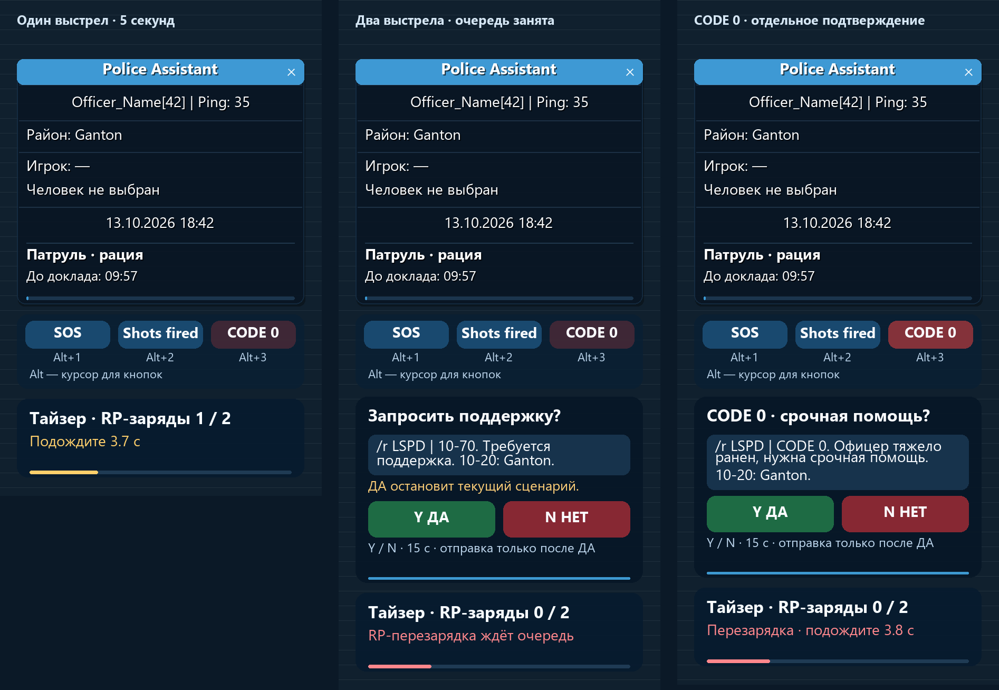

# Руководство Police Assistant

[← На главную](../README.md) · [Установка](INSTALLATION.md) · [Решение проблем](TROUBLESHOOTING.md)

## Рабочий маршрут

**Профиль → нужный человек или машина → действие → предпросмотр → подтверждение → проверка ответа сервера.**

Окна начинают работу примерно на 70% экрана. Потяни край, подбери удобные размеры и включи запоминание в настройках оформления. Положение и размеры сохраняются; при другом разрешении окно подстраивается под доступную площадь. Большие списки и длинные тексты прокручиваются.

## Клавиши по умолчанию

| Клавиша | Действие |
|---|---|
| **F9** | Основное окно PA |
| **X, удерживать** | Радиальное меню; отпусти над нужным действием |
| **F11** | Быстрое меню биндов |
| **F12** | Памятки |
| **F4** | Отдельное окно помощников |
| **End / Esc** | Остановка текущей последовательности / отмена соответствующего окна |
| **Alt+1 / Alt+2 / Alt+3** | Быстрые SOS / Shots fired / CODE 0 с подтверждением |

Назначения меняются в GUI. Существующие пользовательские сочетания сохраняются; при конфликте выбери свободную комбинацию. Нажатия в чате, серверном диалоге и полях ввода не должны запускать фоновые бинды.

### Команды самого PA

| Команда | Действие |
|---|---|
| `/pa26` | Основное окно |
| `/pa26demo` | Переключить деморежим |
| `/pa26cancel` | Отменить текущие действия и снять выбор |
| `/pa26quick`, `/pa26tips` | Быстрое меню и памятки |
| `/pa26run номер [аргументы]` | Подготовить запуск бинда по номеру |
| `/pa26select ID`, `/pa26select off` | Выбрать доступного видимого человека / снять выбор |
| `/pa26hud`, `/pa26hudreset` | Показ HUD / сброс его положения |
| `/pa26sos`, `/pa26shots`, `/pa26code0` | Подготовить соответствующую тревогу |
| `/pa26repair` | Восстановить интерфейс без повторения старых действий |

Серверные команды и короткие команды своих биндов имеют отдельные назначения. `/pa26demo` переключает текущий режим — прежде чем запускать действие, посмотри его состояние в окне.

## Восемь основных разделов

| Раздел | Для чего |
|---|---|
| **1. Главная** | Режим PA, информация и быстрые действия. |
| **2. Библиотека биндов** | Поиск, сценарии, шаги, условия, клавиши, категории и обмен. |
| **3. Помощники службы** | Патруль и экипаж, события, личность, машина и мегафон, розыск, фиксация, обучение и собеседование. |
| **4. Напарники** | Постоянные контакты по нику и переход к текущему экипажу. |
| **5. Памятки и справка** | Заметки, избранное, чтение и отдельное окно памяток. |
| **6. База знаний** | Источники, поиск, избранное, недавнее и отдельно подписанные личные редакции. |
| **7. Журнал и статистика** | Сводка, журнал биндов, команды и ответы сервера, системный лог. |
| **8. Настройки** | Шесть групп, описанных ниже. |

**«Обновления PA»** находятся над этими разделами. [Как обновляться](UPDATES.md).

## Где искать настройки

| Группа | Что настраивается |
|---|---|
| **1. Профиль** | Данные персонажа, род, часы, экипаж, префиксы волн и ручные значения места/госномеров. |
| **2. Чат и команды** | Акцент и .команды; перенос речи, рации и /todo; RP перед ручными командами; фильтры и CEF. |
| **3. Управление и колесо** | Клавиши, расстояния, интервалы, выбор человека, люди рядом, карточки, секции и действия колеса. |
| **4. Рация и тревоги** | Экстренные доклады, периодические доклады, предупреждения и свои расписания. |
| **5. Оружие и тайзер** | Доставание/убирание, тайзер и предупреждения оружием. |
| **6. Экран, HUD и карта** | Окна и режим, HUD, карта, восстановление после ошибок. |

F4 открывает компактное окно: патруль, мегафон, фиксация, обучение и уведомления. Из него есть переход к настройкам чата. Переключатель **РЕАЛЬНЫЙ РЕЖИМ / ДЕМО РЕЖИМ** находится в **F9 → Настройки → 1. Профиль** и сохраняет выбор. Первая установка начинается в реальном режиме. Для проверки бинда без отправки включи демо перед запуском.

## Подтверждение ручной команды

После ввода `/cuff ID` и других включённых команд PA удерживает исходную команду и предлагает три варианта:

- **ДА — отыграть RP и выполнить**: сначала ваш подходящий бинд (он имеет приоритет), иначе резервная отыгровка; затем исходная команда один раз.
- **НЕТ — выполнить сразу без RP**: отправить только исходную команду.
- **Отменить всё (Esc) — не отправлять**: отменить и RP, и команду.

Для розыска финальная кнопка отдельно подписана «Выдать розыск» или «Открыть список» в зависимости от настройки. Отправленная RP-ориентировка ещё не означает выдачу звёзд.

## Род в шаблонах функций

В репликах оружия, тайзера, предупреждений, рации, патруля, транспорта и процедур доступна запись `{gender:передал|передала}`. PA выбирает вариант по полю **Профиль → Грамматический род**. Предпросмотр показывает готовую строку. Старые тексты без этой записи остаются без изменений.

Бинды пользователя обновлением не переписываются. В **Чат и команды → Автоперенос и /todo → Обновить стандартные отыгровки** можно отдельно просмотреть предлагаемые замены прежних стандартных текстов функций вне библиотеки биндов. Личные изменения сохраняются.

## Человек и радиальное меню

Закрепи человека через выбор при наведении ПКМ или список рядом. Фракция не исключает офицеров из взаимодействия. Колесо показывает категории; наведи на нужную, затем на конкретное действие внешней дуги. Центр и пустая область ничего не запускают. Часть действий открывает форму параметров.


*Демонстрационный пример интерфейса. Состав дуг зависит от твоих биндов и профиля колеса.*

В настройках можно сохранять выбранного человека при переходе между интерьером и улицей. Сохранённая карточка не разрешает действие на невидимом или недоступном игроке: перед отправкой условия проверяются снова. Удалённый розыск — отдельный разрешённый сценарий, описанный [здесь](WANTED.md).

## HUD и быстрые тревоги

HUD показывает свои данные, район и выделенный квадрат карты, выбранного человека и доступное состояние. Его положение и оформление настраиваются. Район и квадрат доступны также подходящим шаблонам докладов.



*Схема прежнего демонстрационного состояния: HUD, тазер и подтверждение тревоги. Тексты и расположение в текущем выпуске могут отличаться.*

SOS, Shots fired, CODE 0 и другие предусмотренные доклады показывают адресатов и готовый текст до отправки. ДА — зелёная кнопка, НЕТ — красная. Уже отправленный текст отменой следующего шага не отзывается.

## Патруль и рация

Задай подразделение, экипаж, позывной и настройки докладов. Начни смену/патруль, используй ручные действия или включи предусмотренные периодические отчёты. Переменные района и квадрата берутся из доступного игрового контекста; ручные поля имеют явный источник. Проверь канал, текст и интервал до включения таймера.

Для критичных докладов действует предпросмотр. Очередь предупреждений не должна незаметно продолжаться после смены сцены, персонажа или режима. История PA — локальный учёт, а не подтверждение серверного отчёта.

## Транспорт, мегафон и оружие

Выбери конкретную машину для остановки или погони. Модель, цвет и доступные данные подставляются в шаблоны. В мегафоне доступны свои требования, каналы, условия «пешком/в машине/остановка/погоня» и сочетания. Клавиша сначала готовит подтверждение.

Отыгровки доставания и уборки оружия, предупреждение при удержании прицела, тазер и применимые паузы редактируются через настройки. Интервалы, для которых предусмотрены секунды, позволяют выбрать от 1 секунды. RP-перезарядка не означает реальную серверную перезарядку, если соответствующее действие не настроено и не проверено.

`/pt`, доклад о погоне и `/setmark` выполняют разные задачи. Синтаксис неподтверждённой команды нельзя выводить из её названия.

## Живой чат и длинные реплики

После Enter PA может продолжить длинный текст по словам, добавляя `...` на границах частей. Максимум — три части. Проверяется фактическая длина отправки в CP1251, включая префиксы и команду. Если весь текст нельзя безопасно уложить, частичная очередь не начинается.

Поддержаны обычная речь, `/me`, `/do`, `/try`, выбранные каналы рации и OOC, в том числе `/r`, `/rn`, `/f`, `/fn`, `/d`, `/df`, `/n`. Включение каналов, лимиты, маркеры и задержки проверь в настройках чата. Команды с серверными аргументами не разбиваются произвольно.

```text
/todo Приметы подозреваемого: высокий, на вид 25 лет, ...*обращаясь по рации к диспетчеру.
/todo ...одет в тёмную куртку и синие джинсы.*обращаясь по рации к диспетчеру.
```

Действие после `*` повторяется; его предел — **60 символов**. Автоматический акцент ставится в начале обычной речи, продолжение получает только маркер. Подробности и ограничения — в настройках и [разделе проблем](TROUBLESHOOTING.md).

## Заметки, знания, обучение и фиксация

Заметки имеют отдельный файл обмена. База знаний предлагает поиск, избранное и недавние карточки; личная версия правила подписывается отдельно и не меняет официальный снимок. Сверяй дату источника: обновление программы само по себе не доказывает актуальность законов.

В обучении можно составить свои вопросы и отмечать, что нужно повторить. Фиксация помогает подготовить время и проверить указанный файл снимка. Сам снимок делай через F8: PA не выдаёт проверку файла за доказательство события или принятие отчёта сервером.

## Настройки и уведомления

Все редактируемые реплики имеют русские поля, объяснение переменных и предпросмотр. Успешное фоновое сохранение может быть тихим; результат явной кнопки и ошибка показываются отдельным окном. Если запись не удалась, не закрывай правки поспешно: сначала прочитай причину и повтори сохранение.
