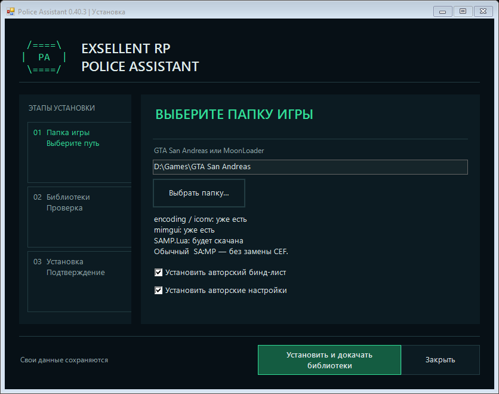

# Установка Police Assistant

[← На главную](../README.md) · [Руководство](GUIDE.md) · [Обновления](UPDATES.md)

## Что нужно заранее

Windows 7 SP1 / 10 / 11 с Windows PowerShell 5.1 и .NET Framework 4.5.2 или новее, рабочая GTA San Andreas / SA:MP и установленный **MoonLoader 0.26**. Игра должна запускаться до установки PA. В папке игры должны находиться `gta_sa.exe` (или `gta-sa.exe`), `moonloader.asi` и `lua51.dll`.

Игра, SA:MP, ASI-загрузчик и сам MoonLoader не устанавливаются автоматически. Сначала установи совместимую основу своей сборки. PA не меняет игровые EXE, ASI и `lua51.dll`.

На Windows 7 сначала прочитай [подготовку Windows](WINDOWS-COMPATIBILITY.md): нужны SP1, .NET и WMF 5.1. Запуск от администратора не исправляет старую версию PowerShell. Штатная проверка ничего не пишет в игру, пока компонентов не хватает.

## Установка через помощник

1. В [последнем Release](https://github.com/VIBAG-bg/Police-Assistant/releases/latest) скачай **`Police-Assistant-v0.40.3.zip`**. Архив **Source code** предназначен для разработки.
2. Полностью закрой GTA и распакуй **весь** архив в отдельную папку.
3. Запусти **`Установить PA.cmd`** и выбери папку своей GTA либо её папку `MoonLoader`. Для Exsellent Launcher обычно это `%LOCALAPPDATA%\Exsellent Launcher\game`.
4. Справа появятся сведения о библиотеках. Нажми **«Установить PA»** либо **«Установить и докачать библиотеки»**. Если не хватает библиотек, помощник перечислит их и скачает после этой кнопки. Он получает закреплённые версии из исходных источников, проверяет архивы и каждый выбранный файл перед установкой.
5. Дождись сообщения об успешной установке. Затем запусти игру и нажми **F9**.

Если проверка остановилась, причина останется в окне установщика. Файлы сначала подготавливаются вне игры; ошибка загрузки или проверки архива не начинает установку. [Решение проблем](TROUBLESHOOTING.md).

### Для лаунчера и обычной сборки

| Клиент | Как устанавливается PA |
|---|---|
| **Exsellent Launcher** | PA и мост к проверенному CEF-чату. Основной `main.js` лаунчера не заменяется. |
| **Обычный SA:MP** | Тот же PA со стандартным игровым чатом. Папка CEF не создаётся. |
| **Другой CEF-клиент** | PA устанавливается, посторонний HTML и скрипты чата остаются без изменений. Интеграция такого CEF требует отдельной проверки. |

Совместимость CEF определяется по контрольной сумме официального HUD. Если в известной папке Exsellent Launcher его версия изменилась, помощник остановится до установки. Не подменяй контрольную сумму ради обхода проверки.

## Какие библиотеки можно докачать

| Комплект | Источник | Что выбирается из архива |
|---|---|---|
| encoding / iconv | [MoonLoader 0.26, BlastHack](https://www.blast.hk/moonloader/) | `encoding.lua`, `iconv.dll` и сопроводительные лицензии |
| mimgui 1.7.1 | [Пакет автора FYP в LuaRocks](https://luarocks.org/modules/fyp/mimgui/1.7.1-1) | Lua-модули, согласованная x86 DLL и лицензия |
| SAMP.Lua 2.3.0 | [THE-FYP / SAMP.Lua](https://github.com/THE-FYP/SAMP.Lua) | `samp/events.lua`, остальные модули `samp/` и лицензия |

Адреса, размеры и SHA-256 закреплены в `DEPENDENCIES.json`. Автоматического перехода на неизвестную «последнюю библиотеку» нет. Полный уже установленный комплект сохраняется, даже если его версия отличается. При неполном комплекте файлы можно дополнить только совместимыми: несовпадение существующих Lua/DLL остановит установку, чтобы не смешать версии. В этом случае восстанови цельный комплект библиотеки из своей сборки и повтори установку.

CEF не является условием для обычного чата. SAMP.Lua нужен для обработки серверных событий: ручных команд, показа паспорта, фильтров чата и событий тазера. Сам SAMP.Lua требует совместимой поддержки SAMPFUNCS в клиенте. Если её нет, эти события недоступны даже при наличии Lua-файлов. Установщик PA не добавляет ASI-плагины: основу клиента и SAMPFUNCS нужно подготовить отдельно.

## Что будет с моими данными

Существующий INI, JSON с биндами, заметками, настройками и личной базой не заменяются. Перед установкой копируются личные файлы `police_assistant_2026*` из `MoonLoader/config`, а также заменяемые программные файлы. Копии находятся рядом с распакованным установщиком в **`installation-backups/before-…`**. Не удаляй эту папку, пока не проверишь результат.

Помощник проверяет изменения файлов во время подготовки. При обычном сбое возвращает затронутые программные файлы; более новые внешние правки не затирает. Если GTA запустилась посреди установки, он остановит дальнейшую запись: закрой игру и повтори установку из того же полного архива. Материалы восстановления сохраняются. Не запускай два установщика одновременно.

## PowerShell и проверка без записи

Из папки распакованного архива:

```powershell
powershell.exe -NoProfile -ExecutionPolicy Bypass -File .\install.ps1 -DestinationRoot "D:\Games\GTA San Andreas" -FetchDependencies
```

Без `-DestinationRoot` используется стандартная папка Exsellent Launcher. Без `-FetchDependencies` недостающие библиотеки только сообщаются: загрузки не будет. Параметр ExecutionPolicy относится к этому процессу, системная политика не меняется.

```powershell
powershell.exe -NoProfile -ExecutionPolicy Bypass -File .\install.ps1 -DestinationRoot "D:\Games\GTA San Andreas" -VerifyOnly
```

`-VerifyOnly` проверяет комплект PA, выбранную папку и список недостающих библиотек; не скачивает и не устанавливает файлы. Он не исполняет сторонние DLL и не подтверждает их работоспособность в игре.

## Ручная установка

1. Закрой GTA. Сделай копию `MoonLoader/config` и установленного PA.
2. Убедись, что библиотеки из таблицы выше установлены полными совместимыми комплектами.
3. Перенеси из `moonloader/` релизного архива главный скрипт, `pa26_guard.lua`, модули `lib/pa26_*.lua` и папку `resource/pa26/` в свою `MoonLoader`.
4. Стартовый `config/police_assistant_2026.ini` переноси **только если своего файла ещё нет**. Никогда не копируй чужой config поверх своего.
5. Для обычного SA:MP папку `cef/` из архива не копируй. Для Exsellent Launcher используй помощник установки: он проверяет HUD и подключает адаптер с копией исходного HTML.

Дождись **«Готово — можно запускать GTA»**. Окно можно свернуть; крестик закрытия недоступен во время записи. При раннем открытии игры установка ждёт её закрытия. Ошибка показывается отдельным окном; логи и резервные копии остаются в `installation-backups` рядом с распакованным PA.



## Авторские наборы

Две галочки включены по умолчанию: авторские бинды и авторские настройки. Их можно отключать отдельно. При переустановке свои значения сохраняются; чистая установка получает выбранные наборы и две стандартные памятки. [Подробные правила](AUTHOR-PRESETS.md).

## Первый запуск

При первой установке включён деморежим. В F9 настрой профиль, проверь предпросмотр, назначь клавиши и только после этого отключай деморежим. Самостоятельная отправка Enter в игровом чате остаётся реальной отправкой даже в деморежиме PA.

При переходе со старого общего формата PA проверяет перенос в отдельные JSON; исходная библиотека остаётся снимком. Ошибка запуска не считается успешной загрузкой интерфейса: исправь указанную зависимость и перезапусти игру.
