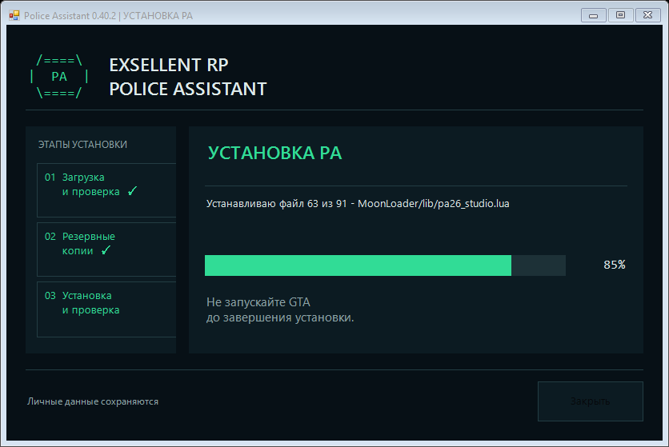

# Обновление из GitHub

[← Руководство](GUIDE.md)

## Пользователю

1. Открой F9 → **«Обновления PA»**, над разделами 1–8.
2. Источник должен быть **`VIBAG-bg/Police-Assistant`**.
3. Нажми **«Проверить обновления»** и прочитай описание новой версии.
4. Нажми **«Скачать и установить после выхода»**. Дождись окна, что пакет готов.
5. Полностью выйди из GTA. Дождись **«Готово — можно запускать GTA»** в отдельном окне, затем запусти игру снова.

База знаний приходит вместе с программой. Если база уже была установлена, PA сохраняет её активную редакцию: после обновления открой **«База знаний → Данные → Посмотреть базу из обновления PA»**, затем **«Применить базу» → ДА**. Личные карточки и заметки сохраняются; изменённые первоисточники могут потребовать сверки личных правок. [Сверка для 0.38.1](FORUM-REVIEW-2026-10-25.md).

Проверка при входе настраивается отдельно и по умолчанию выключена. Она не разрешает автоматическое скачивание. Предварительные выпуски подключаются отдельным переключателем. Сетевое ожидание — от 1 до 120 секунд. Пароли и токены не нужны.

Если у тебя уже стояла ранняя 0.38.0-dev с пустым источником, впиши репозиторий в поле один раз: сохранённые пользовательские настройки намеренно имеют приоритет над новым стандартом.

## Окно прогресса

В настройках обновлений есть переключатель **«Показывать отдельное окно установки»**, по умолчанию включён. Окно на русском показывает загрузку, проверку, копии и запись файлов. Его можно свернуть. Проценты меньше 100 не разрешают запускать GTA; 100% появляется после проверенного результата и снятия блокировки установки. Красный результат означает ошибку; восстановленная прежняя версия подписана отдельно.

Если открыть GTA слишком рано, помощник попросит её закрыть и продолжит установку. Это не заменяет восстановление после настоящей ошибки или завершения процесса.

**Первый переход с 0.40.1 и старее.** Его выполняет прежний установленный worker, и новое окно не может появиться задним числом. Скачай и распакуй полный ZIP, сначала запусти загрузку в PA, затем открой **«Показать обновление PA.cmd»** и выбери ту же папку игры. Он подключается к текущему или последнему результату выбранной установки и ничего не записывает в игру. Для следующего задания открой просмотр заново. Со следующего обновления новое окно включается автоматически. На первом переходе не запускай GTA до подтверждения: запись ещё выполняет прежний помощник. Не запускай полный установщик одновременно с обновлятором.

Для Windows 7 SP1 необходимы PowerShell 5.1, .NET 4.5.2+ и рабочий TLS 1.2. [Подготовка Windows](WINDOWS-COMPATIBILITY.md).

## Что происходит с файлами

- Пакет `pa26-update.zip` может содержать только разрешённые программные файлы PA. Пользовательские JSON/INI не допускаются.
- SHA-256 архива берётся из метаданных GitHub; проверяются размеры, пути, формат хранения, версия и каждый файл. Доверенным источником остаётся выбранный репозиторий.
- После выхода из GTA сохраняются **свежие** личные файлы, включая правки, сделанные после скачивания.
- Помощник не заменяет runtime при запущенной GTA. Маркер не позволяет PA загрузить смесь версий при прерывании установки.
- Сбой вызывает восстановление затронутых программных файлов. Более новые личные данные автоматически не заменяются старыми копиями.
- Если копия повреждена или файлы изменены извне, восстановление останавливается с сохранением материалов для проверки.

Резервные копии и отчёты: **«Открыть резервные копии и отчёты»**, хранилище `%LOCALAPPDATA%\PoliceAssistant2026\updates`. Копии автоматически не удаляются. До начала установки отложенную загрузку можно отменить на странице обновлений.

## Для автора релиза

Публикуй `pa26-update.zip` именно под этим именем в GitHub Release. Обычный канал читает последний стабильный релиз; тег `v0.40.2` соответствует версии `0.40.2` в Lua, INSTALL_MANIFEST и манифесте ZIP. GitHub должен возвращать `digest: sha256:...` для загруженного asset. Один исходный Git-тег или архив Source code не являются пакетом обновления.

Протокол 1 требует побайтно одинакового `pa26_update_platform.lua`. Изменение загрузчика или несовместимый формат личных данных требуют отдельной ручной установки и миграции. [Сборка и выпуск](DEVELOPMENT.md).

## Обычный клиент и CEF лаунчера

Обновление выбирает фактическую папку запущенного PA. Хранилища и резервные копии разных установок разделены. Универсальный пакет 0.40.2 содержит только файлы MoonLoader: адаптеры CEF совпадают с 0.40.0 и остаются в лаунчере без замены. Поэтому пакет принимает и прежний загрузчик обычного SA:MP, который раньше ожидал CEF при наличии таких файлов в архиве.

При сборке проверяется `UPDATE_CEF_BASELINE.json`: изменённые адаптеры нельзя незаметно исключить из обновления. Для новой установки лаунчера они по-прежнему входят в полный ZIP. Для старой установки с отсутствующим или повреждённым CEF-мостом используй полный установщик: универсальный пакет не восстанавливает удалённые адаптеры.

Встроенная кнопка обновляет PA. Установка самой основы MoonLoader и докачка сторонних библиотек выполняются отдельным помощником из полного ZIP, а не фоновым обновлением. Обновление уже работающего PA не заменяет сторонние DLL.
