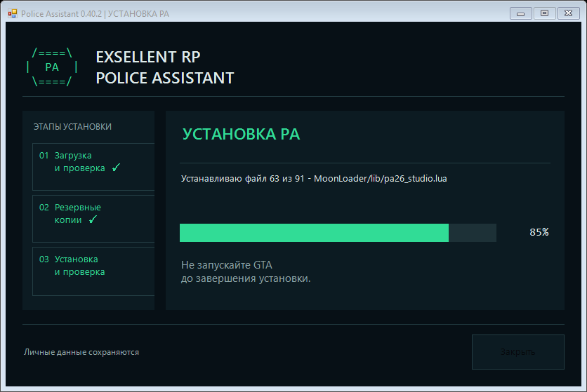

> **CEF hotfix 04.11.2026:** вместо единственного SHA используется общий проверяющий контракт и подтверждение запуска. Актуальные границы и установка: [адаптивный CEF](CEF-ADAPTIVE-0.45.0.md). Прежние утверждения о замороженном CEF/безусловном отказе для нового SHA относятся к состоянию до этого hotfix.

# Как обновлять Police Assistant

> **Переход на 0.46.1.** Выбери «Скачать и установить после выхода», затем закрой GTA. На совместимой сборке Exsellent Launcher PA восстановит адаптер при первом запуске. [Порядок перехода](RELEASE-0.46.1.md).

[← Руководство](GUIDE.md) · [Установка](INSTALLATION.md) · [Авторские наборы](AUTHOR-PRESETS.md)

В PA есть **три независимых обновления**. Выбирай нужное — одно не заменяет другое.

| Что обновляем | Что произойдёт |
|---|---|
| **Программу PA** | Установится новая версия помощника. При первом переходе на 0.46.x добавятся авторские бинды и обновятся стандартные настройки. Личные сценарии и правки сохраняются. |
| **Авторский бинд-лист** | PA покажет список изменений. Подтверждение обновляет неизменённые авторские бинды, сохраняет личные записи и создаёт резервную копию. |
| **Авторские настройки** | Применится свежий авторский набор оформления, колёс, функций и RP-шаблонов. Профиль, бинды и заметки сохраняются. |

## Обновить саму программу

1. Открой **F9 → Обновления PA**.
2. Убедись, что источник — `VIBAG-bg/Police-Assistant`.
3. Нажми **«Проверить обновления»** и прочитай, что изменилось.
4. Выбери **«Скачать и установить после выхода»**. Дождись сообщения о готовности пакета.
5. **Полностью закрой GTA.** Подожди сообщения **«Готово — можно запускать GTA»**, затем запускай игру.

Просто перезагрузить скрипт PA недостаточно: установка программных файлов выполняется после выхода из игры.

**Автоматическая загрузка не запускается сама собой.** Проверка новой версии при входе настраивается отдельно и по умолчанию выключена; окончательное скачивание требует твоего действия. Пароль и токен GitHub не нужны.

### Обновление базы знаний

База знаний входит в новую версию программы, но твоя установленная редакция не заменяется молча. Если нужна база из нового выпуска, открой **База знаний → Данные → Посмотреть базу из обновления PA → Применить базу → ДА**. Личные заметки и карточки сохраняются; изменения источников при необходимости сверь отдельно.

## Получить свежие авторские бинды или настройки

1. Открой **F9 → Обновления PA**.
2. Выбери **«Обновить бинд-лист с GitHub»** или **«Обновить настройки с GitHub»**.
3. Прочитай предупреждение и реши, применять ли замену. **НЕТ** или **Esc** отменяют её.

Эти кнопки скачивают отдельные авторские наборы из последнего стабильного релиза и дают предпросмотр. При встроенном переходе на 0.46.0 первичное объединение выполнится автоматически.

- **Бинд-лист объединяется с личными сценариями.** PA обновляет распознанные стандартные записи и добавляет новые. Если новая запись претендует на уже занятую команду или клавишу, действующее назначение сохраняется.
- **Настройки обновляются отдельно**. Бинды, профиль, контакты, заметки, история и выбранный режим демо сохраняются.
- Перед заменой создаются резервные копии. После успешного применения перезапускается только скрипт PA — выходить из GTA не нужно.

Подробности: [что входит в авторские наборы, где лежат копии и как восстановить данные](AUTHOR-PRESETS.md).

## Окно установки обновления

Отдельное окно показывает ход загрузки, проверки, создания копий и установки. Его можно свернуть. **Не запускай GTA, пока не появится сообщение об успешном завершении.**

Если игра откроется слишком рано, установщик попросит закрыть её. При ошибке он покажет причину и, если возможно, восстановит прежние программные файлы.

Для Windows 7 SP1 требуются PowerShell 5.1, .NET Framework 4.5.2+ и TLS 1.2. [Как подготовить Windows 7](WINDOWS-COMPATIBILITY.md).

## Если обновление не удалось

- Проверь интернет, источник `VIBAG-bg/Police-Assistant` и сообщение об ошибке.
- Если пакет ждёт выхода, полностью закрой GTA и дождись завершения.
- **Не удаляй** резервные копии, журнал или маркер незавершённой установки ради обхода проверки.
- Если встроенный старый обновлятор не может исправить сам себя, скачай **полный установочный ZIP без пометки `before`** из [последнего релиза](https://github.com/VIBAG-bg/Police-Assistant/releases/latest) и установи его при закрытой игре.

[Все частые проблемы и восстановление →](TROUBLESHOOTING.md)

## Если у тебя очень старая версия

**0.40.4 — ошибка пути к резервной копии.** Формат исправлен в 0.41.0. Один раз установи полный архив по [инструкции восстановления](UPDATER-PATHS-041.md); старый загруженный обновлятор до установки исправления не изменится.

**Первый переход с 0.40.1 и старее.** Прежний обновлятор не умеет сам показать новое окно прогресса. Скачай полный ZIP, начни загрузку через PA, затем открой **«Показать обновление PA.cmd»** из архива и укажи ту же папку игры. Это окно только показывает состояние задания. Не запускай одновременно полный установщик и встроенный обновлятор.

**0.38.0-dev с пустым источником.** Впиши `VIBAG-bg/Police-Assistant` в настройках обновлений один раз: старое сохранённое пользовательское значение не заменяется новым стандартом автоматически.

---

## Технические подробности

## Как PA защищает файлы

- Пакет `pa26-update.zip` может содержать только разрешённые программные файлы PA. Пользовательские JSON/INI не допускаются.
- SHA-256 архива берётся из метаданных GitHub; проверяются размеры, пути, формат хранения, версия и каждый файл. Доверенным источником остаётся выбранный репозиторий.
- После выхода из GTA сохраняются **свежие** личные файлы, включая правки, сделанные после скачивания.
- Помощник не заменяет runtime при запущенной GTA. Маркер не позволяет PA загрузить смесь версий при прерывании установки.
- Сбой вызывает восстановление затронутых программных файлов. Более новые личные данные автоматически не заменяются старыми копиями.
- Если копия повреждена или файлы изменены извне, восстановление останавливается с сохранением материалов для проверки.

Резервные копии и отчёты: **«Открыть резервные копии и отчёты»**, хранилище `%LOCALAPPDATA%\PoliceAssistant2026\updates`. Копии автоматически не удаляются. До начала установки отложенную загрузку можно отменить на странице обновлений.

## Для автора релиза

Публикуй `pa26-update.zip` именно под этим именем в GitHub Release. Обычный канал читает последний стабильный релиз; тег `v0.40.2` соответствует версии `0.40.2` в Lua, INSTALL_MANIFEST и манифесте ZIP. GitHub должен возвращать `digest: sha256:...` для загруженного asset. Один исходный Git-тег или архив Source code не являются пакетом обновления.

Протокол 1 требует побайтно одинакового `pa26_update_platform.lua`. Изменение загрузчика или несовместимый формат личных данных требуют отдельной ручной установки и миграции. [Сборка и выпуск](DEVELOPMENT.md).

## Обычный клиент и CEF лаунчера

Обновление выбирает фактическую папку запущенного PA. Хранилища и резервные копии разных установок разделены. Универсальный пакет 0.40.2 содержит только файлы MoonLoader: адаптеры CEF совпадают с 0.40.0 и остаются в лаунчере без замены. Поэтому пакет принимает и прежний загрузчик обычного SA:MP, который раньше ожидал CEF при наличии таких файлов в архиве.

С 0.46.1 встроенное обновление доставляет ту же версию адаптера, что и полный установщик. После проверки совместимости HUD и при включённой поддержке CEF PA восстановит удалённые файлы адаптера. Если страница чата уже открыта, полностью перезапусти GTA. Для первой установки используй полный архив.

Встроенная кнопка обновляет PA. Установка самой основы MoonLoader и докачка сторонних библиотек выполняются отдельным помощником из полного ZIP, а не фоновым обновлением. Обновление уже работающего PA не заменяет сторонние DLL.

## Совместимость пакета 0.46.0

Рабочий пакет сохраняет файлы чата и сначала копирует личную конфигурацию. При первом свободном запуске 0.46.0 PA объединяет авторские бинды с личными и обновляет совпадающие со стандартом настройки одной операцией с резервной копией. Оба авторских колеса показывают до 15 действий перед «Ещё и поиск». Дорожный GPS PA и его граф исключены из 0.46.0, поэтому прежние обновляторы могут применить пакет штатно. Полный установщик подходит для восстановления CEF, если локальный адаптер отсутствует или его контракт не подтверждается. Совместимость чата проверяется при запуске PA.

Авторские бинды и настройки по-прежнему применяются отдельными кнопками. В наборе настроек обновлена только геометрия окон/HUD; RP и бинды сохранены. Явное применение авторского набора заменяет соответствующие личные значения после предупреждения и проверенной резервной копии.
