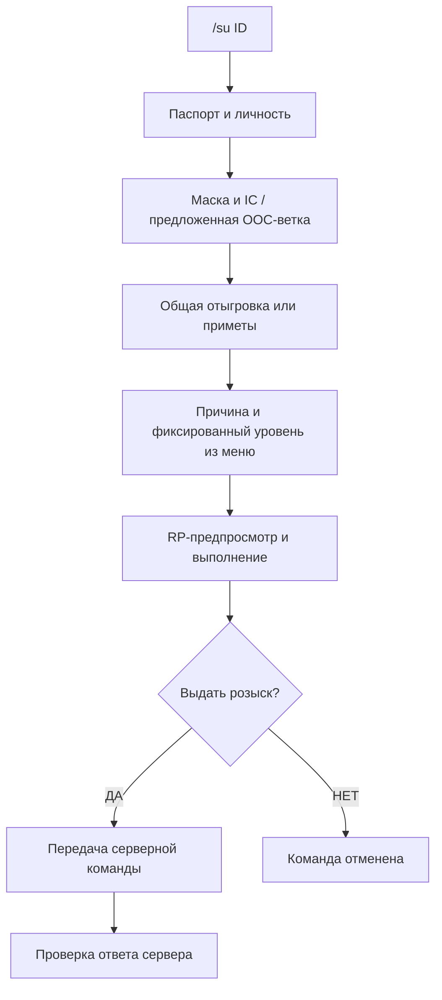

# Розыск: от `/su ID` до результата

[← Руководство](GUIDE.md)

## Обычный сценарий

1. Введи **`/su ID`**. PA открывает собственное отдельное окно розыска. Игрок должен быть подключён; стоять рядом и предварительно выбирать его ПКМ не требуется.
2. Уточни личность. Если PA распознал показ паспорта, сведения предлагаются из доступного контекста. Если ты подтвердил, что паспорт уже видел, IC-имя берётся из ника, а ID используется как номер паспорта по принятой в PA условности. Это не извлечение отдельного серверного номера документа.
3. Ответь на вопросы о маске и доступных IC-основаниях. Маска сама по себе не означает безусловную выдачу OOC: помощник предлагает соответствующую ветку, а решение принимаешь ты с учётом ситуации и правил.
4. Если личность не установлена, выбери **«Общая»** либо **«С приметами»**. Во втором окне введи связное описание: `высокий, на вид 25 лет, в тёмной куртке`.
5. Выбери причину по 13 разделам / 31 пункту. Игровой уровень заранее задан серверным каталогом. Возможные статьи УК/АК показаны как условная справка с ограничениями.
6. Прочитай RP-предпросмотр и запусти отыгровку. Приметы передаются связным `/todo`; длинный текст продолжается с тем же действием после `*`.
7. После RP появится **отдельное окончательное ДА/НЕТ** для серверной команды. НЕТ отменяет команду, уже выполненная отыгровка не повторяется.
8. Проверь ответ сервера. Передача команды не доказывает, что звёзды выданы.

## Правильный смысл команд

| Команда | Значение |
|---|---|
| `/su ID` | В PA — вход в помощник; исходная серверная команда открывает список причин для этого игрока |
| `/su ID раздел подпункт` | Коды выбранного пункта серверного меню |
| `/wanted` | Общий список преступников. Номер дела в нём не считать SA:MP ID |
| `/pt` | Серверная метка погони; отдельна от RP-доклада о погоне |
| `/setmark` | Серверный поиск приблизительного местоположения разыскиваемого |

**Два числа после ID — не «причина и звёзды», не номера УК/АК.** Например, `1 2` — раздел 01, подпункт 02. PA использует подтверждённую пару кодов, а не собирает произвольную команду со свободным количеством звёзд. Параметры `/pt` и `/setmark` сверяй с реальной серверной справкой: их синтаксис здесь не выдумывается.

## OOC-напоминания

Помощник сохраняет выбранный OOC-контекст и предлагает проверить результат / необходимость снятия звёзд. Он не заявляет автоматическое доказательство выдачи и не выполняет скрытый `/clear`. Перед снятием проверь человека и фактический серверный статус.

## Источники

Каталог 13/31 сверён с пользовательскими скриншотами серверных меню от 23.10.2026. Связи с УК/АК основаны на сохранённом снимке правил от 20.10.2026 и являются подсказками PA, а не официальной таблицей пересчёта. IC-годы и игровые звёзды не переводятся друг в друга.

[Подробная таблица соответствий и ограничений](reference/WANTED_WORKFLOW.md).
